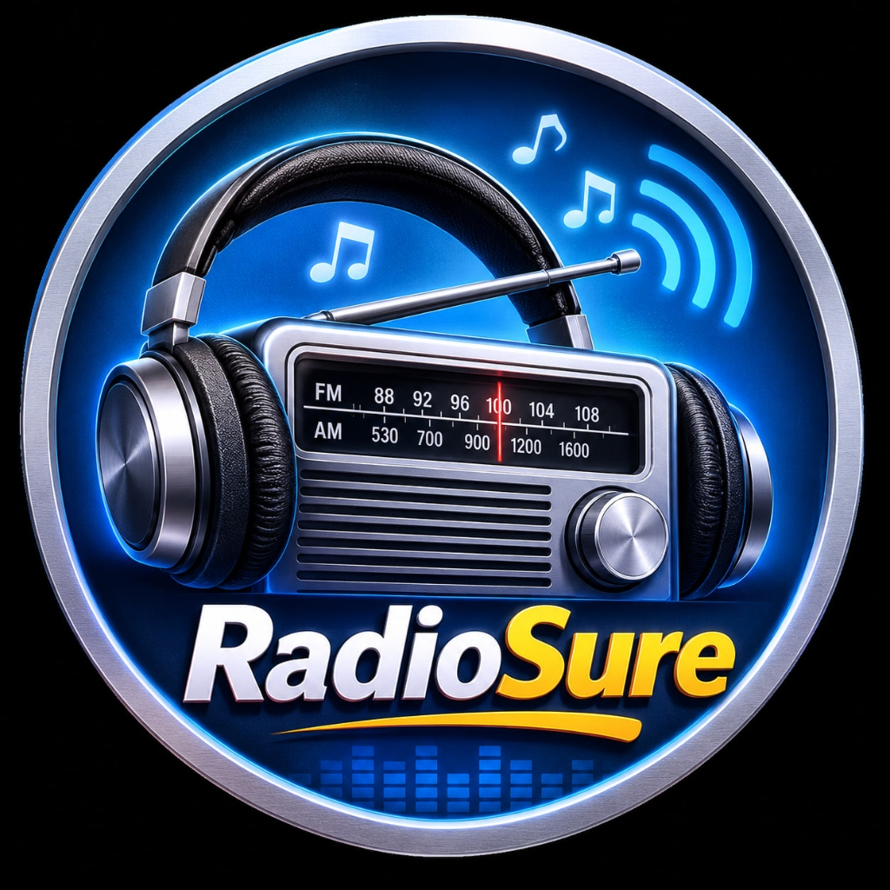
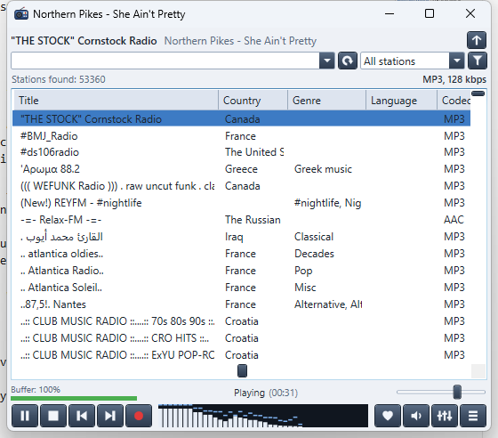
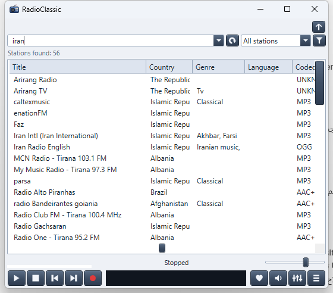

<div align="center">

# RadioSure



**A faithful modern revival of the classic RadioSure internet radio player**


Classic internet radio, rebuilt for modern Windows — 53,000+ stations, instant search, one-click recording, global hotkeys, and a retro interface in 6 themes and 2 languages.



</div>

---

## Highlights

- **53,000+ stations** via the community-driven [radio-browser.info](https://www.radio-browser.info) directory, cached locally in SQLite for instant startup and offline browsing
- **One-click recording** — capture what you hear with a single press, split automatically into per-track MP3/AAC files using stream metadata
- **Instant search** — type a few letters and the list filters live across 53k stations in milliseconds
- **BASS audio engine** — the same proven audio library used by the original RadioSure: fast buffering, gapless reconnects, minimal CPU
- **MP3, AAC, AAC+, OGG, Opus, FLAC, HLS** — codec support well beyond the original
- **Honest playback** — if a station connects but broadcasts silence or stalls mid-stream, RadioSure tells you instead of pretending everything is fine

## Screenshots

| Live instant search | Main player |
|:---:|:---:|
|  |  |

---

## Installation

### Download (recommended)

Grab the latest release from the [Releases](../../releases) page:

| File | Size | Best for |
|---|---|---|
| `RadioSure-Setup-x-online.exe` | ~3 MB | Most users — small download, installs .NET automatically if needed |
| `RadioSure-Setup-x-offline.exe` | ~54 MB | Offline machines — fully self-contained |
| `RadioSure-portable.zip` | ~1 MB | USB stick / no-install — single exe, keeps all data beside itself |

> **Windows 10 1607+ and Windows 11** (x64). The online installer needs an internet connection on first run; the offline installer and portable build do not.

### Portable mode

Extract `RadioSure-portable.zip` anywhere (USB stick, cloud drive, any folder). The single `RadioSure.exe` keeps its database, settings and recordings in a `Data` folder beside itself — nothing is written to your user profile or registry. To convert a regular install into portable mode, place an empty `portable.flag` file next to the exe.

---

## Usage guide

### Playing stations

The station list loads 53,000+ stations on first run (a one-time download of a few megabytes, then cached locally). **Double-click any station to play** — or select it and press **Enter**. The window title shows live track metadata (`Artist — Title`) as it streams, exactly like the original RadioSure.

The transport bar at the bottom:

| Button | Action |
|---|---|
| Play / Pause / Stop / Previous / Next | Playback control — previous/next step through the current list |
| Red circle | **Record** — starts/stops recording of the current station |

While playing, the status bar shows the codec and bitrate (`MP3, 128 kbps`), buffer health, and elapsed time. The animated spectrum visualizes the audio in real time.

### Searching and filtering

Type in the **search box** and the list filters live as you type — a couple of letters is enough to narrow 53,000 stations down to a handful:


Use the dropdowns beside it for precise filtering:

- **All stations / Favorites / Recently played / My stations** — quick views (the star button toggles favorites)
- **Country, Genre, Language, Codec, Bitrate** — combined filters; the genre box is editable, so you can type any genre, not just pick from the list
- The **funnel button** clears all filters at once
- Click any **column header** to sort; click again to reverse

### Favorites, history and custom stations

- **Favorites**: select a station and press the heart button (or right-click) — favorites get their own quick view
- **Recently played** is tracked automatically
- **My stations**: add your own streams (any direct stream URL) via the station menu
- **Import/export** playlists and station lists from the menu — your collection is portable between machines

### Recording

Press the **red record button** while a station is playing. That's it.

- Recordings land in `Documents\RadioSure Recordings\<Station>\` (or `Data\Recordings\` in portable mode)
- When the stream sends track metadata, recording **splits automatically into one file per song**, named `Artist - Title.mp3`
- Files are written in the stream's native format (MP3/AAC) — no re-encoding, no quality loss
- **Scheduled recording**: set up time-based recordings from the recordings menu — great for capturing a show while you're away
- The recordings manager (menu) lets you play back, rename, or delete captures

> Note: with AAC streams, some stations encode silence while their studio is quiet — a file that starts small isn't necessarily broken; it grows as audio arrives.

### Equalizer

The equalizer button (sliders icon) opens a **10-band EQ** with presets. It is off by default; enable it and shape the sound to taste. Settings persist per-profile.

### Compact mode

Switch to the compact mini-player from the view menu — a small always-on-top strip with the essential controls, perfect for keeping in a corner of the screen while you work.

### Themes and languages

- **6 themes**: Classic (default), Dark, Light, Midnight, Retro, High-contrast — switch instantly from the menu, no restart needed
- **2 languages**: English and فارسی (Persian) with full right-to-left layout — the entire UI mirrors automatically

### Tray icon and global hotkeys

RadioSure minimizes to the system tray — closing the window doesn't stop the music. Right-click the tray icon for quick controls.

**Global hotkeys** (work from any application, can be disabled in settings):

| Hotkey | Action |
|---|---|
| `Ctrl+Alt+P` | Play / Pause |
| `Ctrl+Alt+S` | Stop |
| `Ctrl+Alt+N` / `Ctrl+Alt+B` | Next / Previous station |
| `Ctrl+Alt+R` | Toggle recording |
| `Ctrl+Alt+↑` / `Ctrl+Alt+↓` | Volume up / down |

Standard **media keys** on your keyboard (play/pause, next, previous) also work out of the box.

### Honest playback status

Internet radio stations are unreliable by nature — some connect but broadcast digital silence, others stall mid-stream without disconnecting. RadioSure watches for this: after ~8 seconds of silence or stalling it reconnects once automatically, and if the problem persists it **tells you honestly** instead of showing "Playing" forever. No more wondering whether the player or the station is broken.

---

## For developers

### Building from source

```powershell
git clone https://github.com/farhadzadeai/RadioSure.git
cd RadioSure
dotnet build src/RadioSure.sln
```

Requires the **[.NET 10 SDK](https://dotnet.microsoft.com/download)**. Output lands in `src/RadioSure/bin/Debug/net10.0-windows/` — run `RadioSure.exe` from there. No other setup needed: the native audio DLLs (BASS + codec add-ons) are committed under `src/RadioSure/native/x64/` and copied automatically.

### Running tests

```powershell
dotnet test tests/RadioSure.Tests
```

34+ tests cover recording pipeline, codec probing, database queries, stream metadata parsing, the silence watchdog (using a local HTTP server replaying captured silent-stream frames), and WPF binding integrity. Tests that use BASS run in a serialized collection since the audio engine is process-global.

### Creating installers / portable zip

```powershell
pwsh tools/publish.ps1
```

Produces in `dist/`: framework-dependent build, self-contained build, portable zip, and both Inno Setup installers (requires [Inno Setup 6](https://jrsoftware.org/isinfo.php) — edit the ISCC path in `tools/publish.ps1` if installed elsewhere).

### Project structure

```
src/RadioSure/
  Audio/       BASS wrapper, stream playback, metadata parsing, silence watchdog
  Recording/   capture pipeline, track splitting, scheduler, file naming
  Data/        SQLite layer — stations, favorites, history, recordings
  Services/    radio-browser client, hotkeys, tray, single-instance
  Views/       XAML windows — main, compact, equalizer, settings, recordings
  Themes/      6 color themes as resource dictionaries
  Lang/        English + Persian string resources
  native/x64/  bass.dll, bass_aac, basshls, bassopus, bassflac (x64)
tests/RadioSure.Tests/   xunit test suite
installer/     Inno Setup scripts (online + offline)
tools/         publish script, dev utilities
docs/          screenshots used in this README
```

### Architecture in brief

- **WPF on .NET 10** — modern, trimming-ready, self-contained capable
- **BASS** audio engine (same as original RadioSure) — handles MP3/AAC/OGG natively; add-ons cover Opus, FLAC and HLS. Chosen because Windows 11 N lacks Media Foundation
- **SQLite** local cache of the radio-browser directory — instant startup, offline browsing, zero cloud dependency after first sync
- **MVVM-ish** — views bind to view models; services are injectable singletons
- Architecture is intentionally simple: views bind to view models, services are injectable singletons, and the audio layer is a thin wrapper over BASS.

### Contributing

Pull requests welcome. High-impact areas:

- **Translations** — copy `src/RadioSure/Lang/Strings.en.xaml`, translate the values, register in `Loc.cs`
- **Themes** — copy a file in `src/RadioSure/Themes/`, adjust the palette, register in the theme loader
- Bug fixes and codec edge cases — please include a test if you can reproduce the issue in a test

Please keep PRs focused; open an issue first for anything architectural.

---

## Privacy

RadioSure is a desktop app with no accounts, no telemetry, no analytics. The only network traffic is:

1. Fetching the station directory from radio-browser.info (community service, [their privacy policy](https://www.radio-browser.info/terms))
2. Streaming the stations you choose to play
3. Optional update checks if enabled

Your favorites, history and recordings never leave your machine.

## Limitations

- Windows-only (BASS is native x64; no plans for other platforms currently)
- Windows 10 1607+ required for .NET 10 self-contained deployment
- **BASS license**: BASS is free for non-commercial use. If you want to use RadioSure commercially, you need a [BASS license](https://www.un4seen.com/) — the MIT license of this repository covers the RadioSure code, not the BASS binaries

## License

MIT — see [LICENSE](LICENSE). The original RadioSure was freeware by Victor I. Nikonov; this project is an independent clean-room revival inspired by its design, containing no original RadioSure code or assets.

---

## Contact & support

- Email: [Farhadzadeai@gmail.com](mailto:Farhadzadeai@gmail.com)
- Instagram: [@farhadzade.ai](https://instagram.com/farhadzade.ai)
- LinkedIn: [Mohammad Farhadzade](https://www.linkedin.com/in/mohammad-farhadzade/)
- Issues: [GitHub Issues](../../issues)

## Support the project

If RadioSure is useful to you, consider supporting continued development — any amount helps:

**USDT (BEP20 / BSC network):**

```
0x5020005385e2B2e61d57a66159c494b1F7a59FDB
```

Thank you for keeping independent software alive.

---

## Roadmap

Planned for future releases:

- **macOS version** — bringing the classic radio experience to the Mac
- **Android app** — your stations and recordings on the go
- **UI and font improvements** — refined typography, smoother visuals, additional polish across all themes

Suggestions and contributions are welcome — open an issue or reach out through the contact links above.