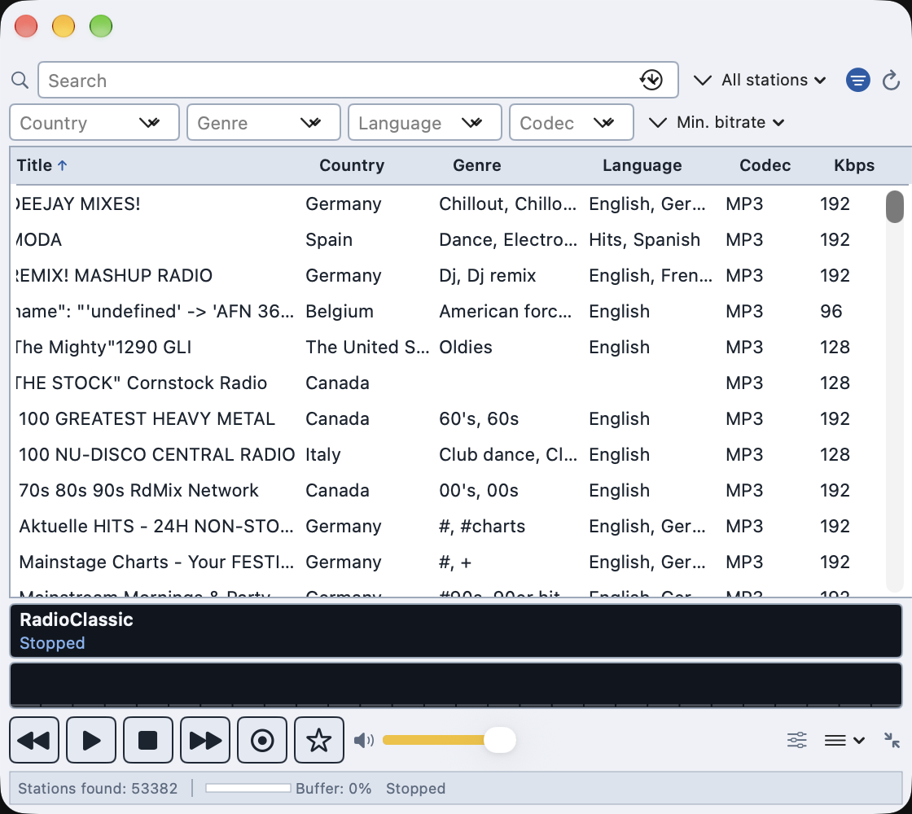

# RadioClassic for macOS

Native macOS version of RadioClassic, written in Swift/SwiftUI.
Developed on the `macos` branch of the RadioSure repository; the Windows version lives on `main`.

## Download the ready-made macOS app

The latest prebuilt macOS version is available from [GitHub Releases](https://github.com/farhadzadeai/RadioSure/releases/latest).

1. Download the macOS DMG or ZIP asset.
2. Move `RadioClassic.app` to `Applications`.
3. The app is currently unsigned and not notarized. On first launch, right-click the app and choose **Open**, then confirm.

## Getting started (on your Mac)

1. Install Xcode 15+ (free, App Store)
2. Clone: `git clone https://github.com/farhadzadeai/RadioSure.git && cd RadioSure && git checkout macos`
3. Open `Package.swift` in Xcode - it opens as a project directly
4. Read `docs/TECH-SPEC.md` first - it is the implementation contract

## Assets ready to use

- `Shared/strings.en.json` / `strings.fa.json` - all 272 UI strings, both languages
- `Shared/themes.json` - all theme palettes from the Windows version

## Rules (same as Windows version)

- Author is Farhadzadeai only - no AI/contributor mentions anywhere
- No machine metadata in commits or builds
- Binaries distributed via GitHub Releases assets, never committed
